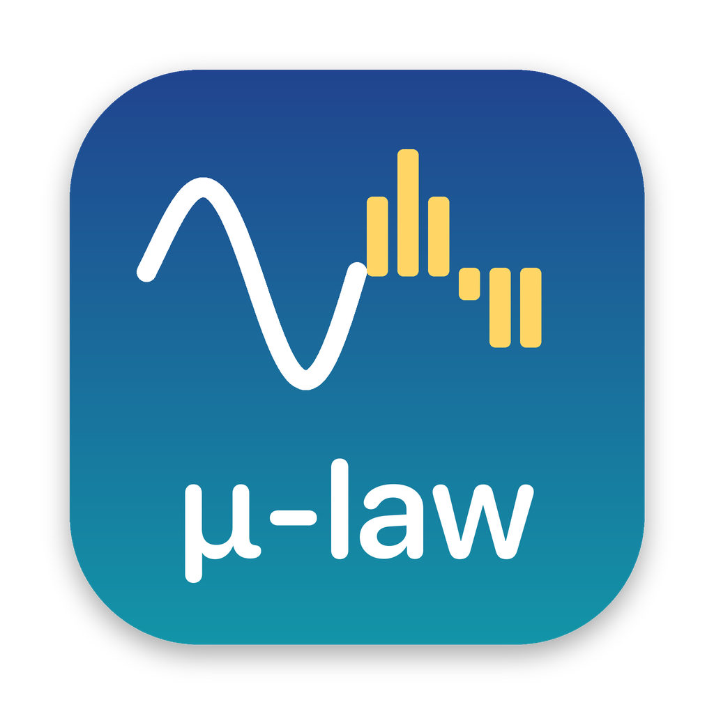

<p align="center"></p>

# CCITT Converter

A macOS app for converting audio files to **CCITT G.711 u-law WAV**: 8 kHz, mono, 8-bit. This is the format phone systems such as Asterisk, FreePBX, Cisco and many hosted VoIP platforms expect for on-hold music, greetings and IVR prompts.

Drop in MP3, M4A, WAV, AIFF and other audio files, click **Convert**, and get phone-ready `name_ulaw.wav` files.

## Features

- **Drag and drop:** drop files or whole folders onto the window or onto the app's Dock icon. Folders are searched recursively for audio files.
- **Batch conversion:** convert any number of files at once, with per-file status and a progress bar.
- **Strict u-law output:** writes a plain `WAVE_FORMAT_MULAW` (0x0007) header with a `fact` chunk. macOS's `afconvert` writes an "extensible" WAV header with padding, which some PBXes reject; this app doesn't.
- **No external dependencies needed:** decoding uses macOS's built-in `afconvert`. If [ffmpeg](https://ffmpeg.org) is installed (`brew install ffmpeg`), it's used instead, which adds formats like FLAC, Ogg and Opus.
- **Command-line version:** the same conversion code can be scripted from a terminal.

## Using the app

Open **CCITT Converter** from Applications, then:

1. Drag audio files or folders into the window, or click **Add Files…**.
2. Choose where to save the results: next to each source file (the default) or a folder you pick.
3. Click **Convert**. Each file shows ✓ or ✗ with the reason, and **Show in Finder** opens the results.

Options:
- **Sample rate:** 8000 Hz by default, the telephony standard.
- **Overwrite existing:** replaces output files that already exist. Otherwise those files are skipped.

## Command line

```bash
uv run converter.py greeting.mp3 "hold music.m4a"     # one or more files
uv run converter.py -o converted/ ~/Music/*.mp3       # save to a folder
uv run converter.py                                   # prompts for filenames
```

| Option | Description |
| --- | --- |
| `-o, --output-dir DIR` | Where to save outputs (default: next to each input) |
| `-r, --rate HZ` | Sample rate (default: 8000) |
| `-s, --suffix TEXT` | Text appended to output names (default: `_ulaw`) |
| `-f, --force` | Overwrite existing output files |

## Development

Requires macOS, Python 3.14+ and [uv](https://docs.astral.sh/uv/).

```bash
uv sync                       # install dependencies
uv run main.py                # run the GUI from source
./build_app.sh                # build dist/CCITT Converter.app
./build_app.sh --install      # build and copy to /Applications
uv run --with pillow make_icon.py   # regenerate icon.png / icon.icns
```

### Project layout

| File | Purpose |
| --- | --- |
| `main.py` | Tkinter drag-and-drop GUI (uses `tkinterdnd2`) |
| `converter.py` | Decoding, G.711 u-law encoding, WAV writing and the command-line interface |
| `CCITT Converter.spec` | PyInstaller build settings for the `.app` bundle |
| `build_app.sh` | Builds and optionally installs the app |
| `make_icon.py` | Draws the app icon |

### How the conversion works

1. The input is decoded and resampled to 16-bit mono PCM at the target rate, using `ffmpeg` or `afconvert`.
2. Each sample is encoded to an 8-bit u-law byte using the standard G.711 algorithm. The encoder is implemented in `converter.py` because Python 3.13 removed the `audioop` module.
3. The bytes are written with a minimal RIFF/WAVE header: an 18-byte `fmt` chunk with format tag 7, plus `fact` and `data` chunks.

## Notes

- The app bundle is built for Apple Silicon (arm64) and isn't signed with an Apple developer certificate. On another Mac, open it the first time by right-clicking it, choosing **Open**, then clicking **Open** again.
- Input files already named `*_ulaw.wav` are skipped when adding folders, so re-dropping a folder doesn't convert the outputs again.
